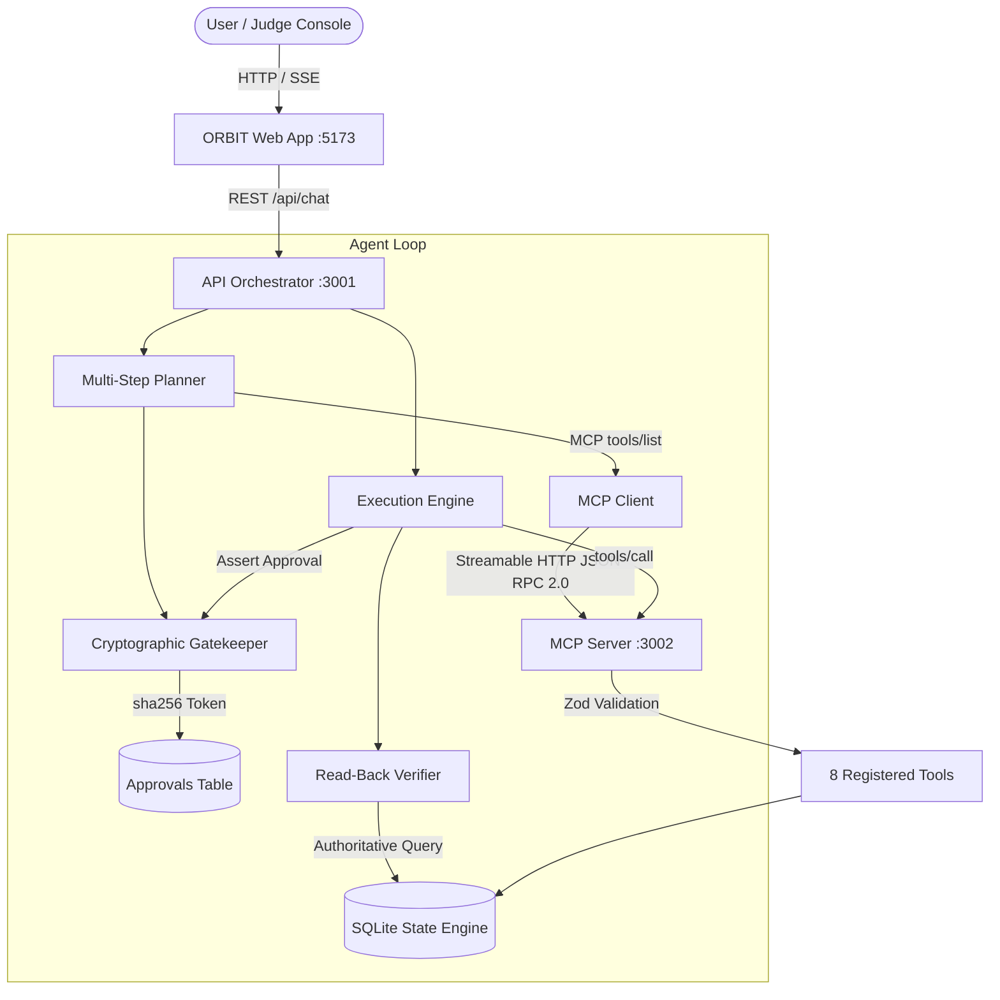

# ORBIT Architecture & Technical Design

## 1. System Philosophy

ORBIT is designed around the core principle: **"A tool call is never successful merely because the model claims it succeeded."**

In real-world personal coordination, autonomous agents that perform unverified writes or hallucinate calendar blocks cause severe real-life disruptions (e.g. double-booked meetings, missed deadlines, or corrupted grocery orders).

ORBIT solves this through a 4-tier safety architecture:
1. **Decoupled Transport via Model Context Protocol (MCP):** Domain logic and tools live in an isolated MCP server communicating strictly over Streamable HTTP and JSON-RPC 2.0.
2. **Deterministic Multi-Step Planning & Conflict Avoidance:** The agent reads existing commitments before proposing any state changes. Overlapping schedule blocks trigger collision detection.
3. **Cryptographic Action Hash Approval:** Proposed state modifications are bound to `sha256(canonicalPayload)`. Writes cannot execute without an active, non-expired approval token matching this exact hash.
4. **Post-Execution Read-Back Verification:** Immediately after a write tool reports success, ORBIT executes an authoritative query against SQLite to confirm record persistence and payload integrity.

---

## 2. Component Topology



---

## 3. Data Schema & Persistence Model

The state engine is powered by SQLite with WAL mode enabled.

### Normalized Tables
- `schedule_blocks`: Stores calendar appointments with `start_at`, `end_at`, `timezone`, `source`. Server-side collision detection queries:
  ```sql
  SELECT * FROM schedule_blocks 
  WHERE NOT (datetime(end_at) <= datetime(?) OR datetime(start_at) >= datetime(?))
  ```
- `tasks`: Action items with `title`, `priority`, `due_at`, `status`, and unique `idempotency_key`.
- `shopping_items`: Inventory with non-destructive quantity increment on deduplicated entries.
- `preferences`: User-confirmed rules and constraints (`study_block_duration`, `preferred_focus_time`, `dietary_notes`).
- `plans` & `plan_steps`: Persisted workflow proposals with step order, tool names, serialized arguments, and execution statuses.
- `approvals`: Human-in-the-loop authorization tokens bound to `action_hash` and TTL expiration.
- `tool_executions`: Full audit trail of every MCP invocation, latency, and status.

---

## 4. Threat & Security Analysis

| Threat Vector | Mitigation in ORBIT |
| :--- | :--- |
| **Unauthorized Write Execution** | Strict gatekeeping rejects write tool calls lacking an approved token (`HTTP 403`). |
| **Payload Tampering Post-Approval** | Re-evaluation of `sha256(canonicalPayload)` on execution. Any mismatch invalidates the approval token. |
| **Schedule Overlaps / Collisions** | Server-side temporal collision verification flags conflicts and prevents double-booking. |
| **Credential Leakage** | All credentials isolated in server-side environment variables; zero secrets emitted to client bundles. |
| **Model Hallucination Loops** | Hard bounded iterations (`MAX_AGENT_ITERATIONS=5`) and 15-second execution timeouts. |
